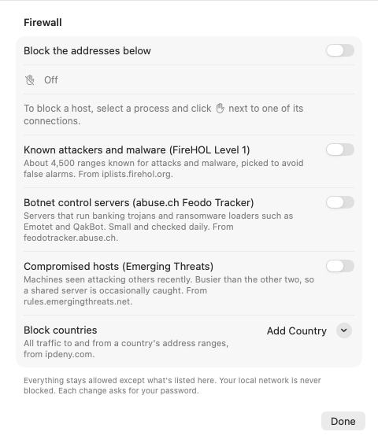

<p align="center"></p>

# macPrune

**See what's really running on your Mac, and cut what you don't need.**

Activity Monitor gives you a long, flat list of names you don't recognize. macPrune shows you *where each process came from*. Every helper, agent and background service sits under the app that owns it, so you can see at a glance that 14 "Helper (Renderer)" processes are really one browser using 3 GB.

Then you can clean them up in one click.

- **Native and light.** Written in Swift and SwiftUI with a 500 KB binary. It uses about 80 MB of memory and low single-digit CPU, and it pauses itself when you can't see it.
- **Private.** No analytics, no accounts. Everything happens on your Mac, and macPrune makes no network requests unless you turn on a firewall block list.
- **Safe by design.** Nothing is ended without a checklist you review first, and core parts of macOS are never offered.

---

## Features

### Process tree with a connection map
Processes nest under their real parent, or under the app macOS holds *responsible* for them, so launchd-spawned XPC services group under their app instead of being scattered. Select any process to see a live map of:

- **Launched by:** the full parent chain
- **Launched:** its child processes
- **Belongs to app / same app group:** everything macOS attributes to the same app
- **Network:** open connections, with remote hosts highlighted
- **Details:** path, start time, threads, GPU, and total memory including children

### The columns you need
Process Name · Real Memory · % CPU · Threads · PID · User · CPU Time · % GPU

Sort by any column, search by name, PID or path, and switch between tree and flat list views. Select one or more rows, then press **⌫** or **End Process** to Quit or Force Quit.

### Three ways to clean

| Button | What it does |
|---|---|
| ✨ **Quick Clean** | Ends idle background items that started with your login, plus anything you've marked *unwanted*. |
| 🍃 **Fresh Start** | Like a restart without restarting: asks every app and background process to quit, except your Do Not Prune list, macPrune itself and the core parts of macOS. Apps with unsaved work still ask first. |
| 🔥 **Purge** | Flags heavy or suspicious processes, and shows the reason for each one. Heavy means CPU, memory or GPU above your thresholds. Suspicious means running from a temp folder or Downloads, using a system process's name from the wrong location, having its executable deleted while still running, or holding unexpected network connections in the background. |

Every clean opens a checklist first. Purge pre-checks only the strong signals, and never pre-checks the app you're currently using.

### Firewall
A gentle firewall, from [NanoWall](https://github.com/ycechungAI/NanoWall)'s Mac version: everything stays allowed, and macPrune blocks only what you choose.

- **Block a host** from the connection map: click ✋ next to any outside connection of the selected process.
- **Threat lists,** each opt-in: known attackers and malware (FireHOL Level 1, about 4,500 ranges chosen to avoid false alarms), botnet control servers (abuse.ch Feodo Tracker) and compromised hosts (Emerging Threats). Each one downloads when you turn it on.
- **Countries:** opt-in, picked by name, from ipdeny.com's ranges.
- **Updates:** Settings and the Firewall sheet show when each list was last downloaded. **Update Lists Now** fetches them again, and lists older than a week are flagged in orange. macPrune doesn't update them silently, because loading new rules asks for your password.

Open it with the ✋ **Firewall** button in the toolbar, View ▸ Firewall… (⇧⌘F), or Settings ▸ Firewall. NanoWall's domain-name block lists aren't included: they work by editing `/etc/hosts` and `/etc/resolver`, which this gentle version never touches.

Your local network can never be blocked: private, local and reserved ranges are always refused, by the app and again by the helper. Each change asks for your admin password, and nothing is installed. The rules go in macOS's own `com.apple` pf anchor, so `/etc/pf.conf` is never edited, and turning the firewall off removes exactly what macPrune added. pf forgets the rules when your Mac restarts; Settings ▸ Firewall then shows **Turn Back On**.

### Do Not Prune list
Right-click any process and choose **Add to Do Not Prune List**. Protected processes are highlighted green and are never offered by any clean. Hide them all with one toggle to focus on everything else. You can **import and export** the list as plain text from Settings or the File menu, to back it up or move it to another Mac.

### Other users
Optionally show processes owned by other accounts, such as `_windowserver`, `_spotlight` or another logged-in user (root is excluded). Ending one asks for your admin password, and they're never included in any clean.

### Whole-Mac memory at a glance
The status bar shows memory pressure (green, yellow or red), a bar split into app, wired and compressed memory, and swap usage. Hover over it for the full breakdown.

### Always on top
Pin the window above everything, including full-screen apps, or switch to **compact mode**: a small top-10 list by memory or CPU that's easy to keep in a corner.

---

## Versions

### 0.2.0 (in development)
Adds a gentle **firewall**, brought over from [NanoWall](https://github.com/ycechungAI/NanoWall)'s Mac version. Everything stays allowed by default, and macPrune blocks only what you choose:

- **A Firewall button** (✋) in the toolbar, also under View ▸ Firewall… (⇧⌘F). It's filled when blocking is on and turns orange when the lists need an update.
- **Block an app's network:** a ✋ in the new **Net** column next to each process blocks every outside address the app (and its helpers) uses, and keeps blocking new ones while macPrune is open, asking for your password at most every 2 minutes. macOS's firewall can only block addresses, so those addresses are blocked for every app. Click the red hand to undo it.
- **Block a host** from the connection map: click ✋ next to any outside connection of the selected process.
- **Three opt-in threat lists:** known attackers and malware (FireHOL Level 1), botnet control servers (abuse.ch Feodo Tracker) and compromised hosts (Emerging Threats).
- **Block countries,** picked by name.
- **List updates:** each list shows when it was last downloaded, **Update Lists Now** fetches them all again, and lists more than a week old are flagged.
- Your local network can never be blocked, `/etc/pf.conf` is never edited, and each change asks for your password. See [Firewall](#firewall) for how it works.
- Tests: `scripts/test.sh` runs the Swift tests and the firewall helper's tests, no root needed.

<p align="center"></p>

0.2.0 isn't released yet: build it from source (below).

### 0.1.0 (released 2026-11-02)
The first release: the process tree with its connection map, Quick Clean, Fresh Start and Purge, the Do Not Prune list, whole-Mac memory, always on top and compact mode. It makes no network requests at all.

[Download macPrune 0.1.0](https://github.com/ycechungAI/macPrune/releases/tag/v0.1.0) (`macPrune.dmg`, macOS 14 or later, Apple Silicon). It isn't notarized yet, so the first time, right-click **Prune** and choose **Open**.

## Install

The easiest way is the [0.1.0 download](https://github.com/ycechungAI/macPrune/releases/tag/v0.1.0). To get the newest version, build it yourself. It takes about a minute.

**Requirements:** macOS 14 Sonoma or later, plus the Xcode Command Line Tools (full Xcode isn't needed).

```bash
xcode-select --install
```

```bash
git clone https://github.com/ycechungAI/macPrune.git
```

```bash
cd macPrune && ./scripts/build-app.sh
```

```bash
open build/Prune.app
```

To keep it, drag `build/Prune.app` into `/Applications`.

## Settings (⌘,)

- Refresh rate: 1, 2 or 5 seconds. In the background it slows to every 5 seconds unless the window is pinned, and it pauses while minimized or covered.
- Purge thresholds for CPU, memory and GPU
- How long after login counts as "started at login" for Quick Clean
- Your Quick Clean (unwanted) and Do Not Prune lists, with import and export

## How it works

| Data | Source |
|---|---|
| Your processes: memory, threads, CPU time, parent, start time | `libproc` (`proc_pidinfo`), read directly from the kernel |
| Which app owns a helper | `responsibility_get_pid_responsible_for_pid` |
| % GPU per process | IOKit GPU client statistics (`AppUsage` → `accumulatedGPUTime`), the same source Activity Monitor uses |
| Other users' processes | `/bin/ps`, which macOS lets read every process |
| Network connections | `lsof`, only for the selected process or during a Purge scan |
| System memory and pressure | `host_statistics64`, `vm.swapusage`, `kern.memorystatus_vm_pressure_level` |

% CPU and % GPU are measured as the change between refreshes, so they appear from the second refresh onward.

### Project layout

```
Sources/Prune/
  PruneApp.swift      App entry, icons, window helpers
  Sampler.swift       libproc / IOKit / ps / lsof sampling, system memory
  ProcessStore.swift  Refresh loop, process tree, ending processes, lists
  Cleaner.swift       Quick Clean, Fresh Start and Purge rules
  ContentView.swift   Table, toolbar, status bar, memory bar
  InspectorView.swift Connection map and details panel
  CleanSheet.swift    Review checklist
  CompactView.swift   Compact top-10 mode
  SettingsView.swift  Settings window
  Firewall.swift      Firewall: address checks, block lists, settings, the helper
  FirewallViews.swift Settings ▸ Firewall and the ✋ button in the connection map
Resources/firewall-helper.sh  Loads the block rules as root (through the password prompt)
scripts/build-app.sh  Builds and ad-hoc signs build/Prune.app
scripts/test.sh       Runs the Swift tests and Tests/helper-test.sh (no root needed)
scripts/ci.sh         Local CI: syntax, tests, build, bundle checks, smoke test
scripts/make-icon.swift  Draws Resources/AppIcon.icns (swift scripts/make-icon.swift)
```

### Tests and local CI

```bash
./scripts/test.sh          # Swift tests and the firewall helper's tests (no root, no network)
./scripts/ci.sh            # everything: syntax, tests, release build, bundle checks, smoke test
./scripts/install-hooks.sh # optional: run ci.sh before every git push from this clone
```

`scripts/build-app.sh` (and so `make-dmg.sh`) runs the tests first and refuses to build if any fail.

The firewall tests run end to end without root: the app's firewall code drives the real
`firewall-helper.sh` in dry-run mode, so its own address checks and `pfctl -n` run for real, with
downloads served from memory. They cover blocking and unblocking, a cancelled password prompt,
helper errors, threat lists (private ranges skipped, caching, weekly staleness, Update Lists Now,
failed downloads), countries, blocked apps and following (batching, the 2-minute limit, pausing),
restarts, and that the app and the helper agree on every address. Only loading the rules into pf
itself needs a person and an admin password.

### Developer switches

```bash
PRUNE_DRYRUN=1 build/Prune.app/Contents/MacOS/Prune
```
Prints what Quick Clean and Fresh Start would offer, then exits. Nothing is ended.

```bash
PRUNE_SNAPSHOT=/tmp/prune.png build/Prune.app/Contents/MacOS/Prune
```
Renders the main window to a PNG five seconds after launch. This doesn't need Screen Recording permission. Add `PRUNE_SNAPSHOT_FIREWALL=1` or `PRUNE_SNAPSHOT_SETTINGS=1` to render the Firewall sheet or Settings instead.

## Roadmap

See [ROADMAP.md](ROADMAP.md).
