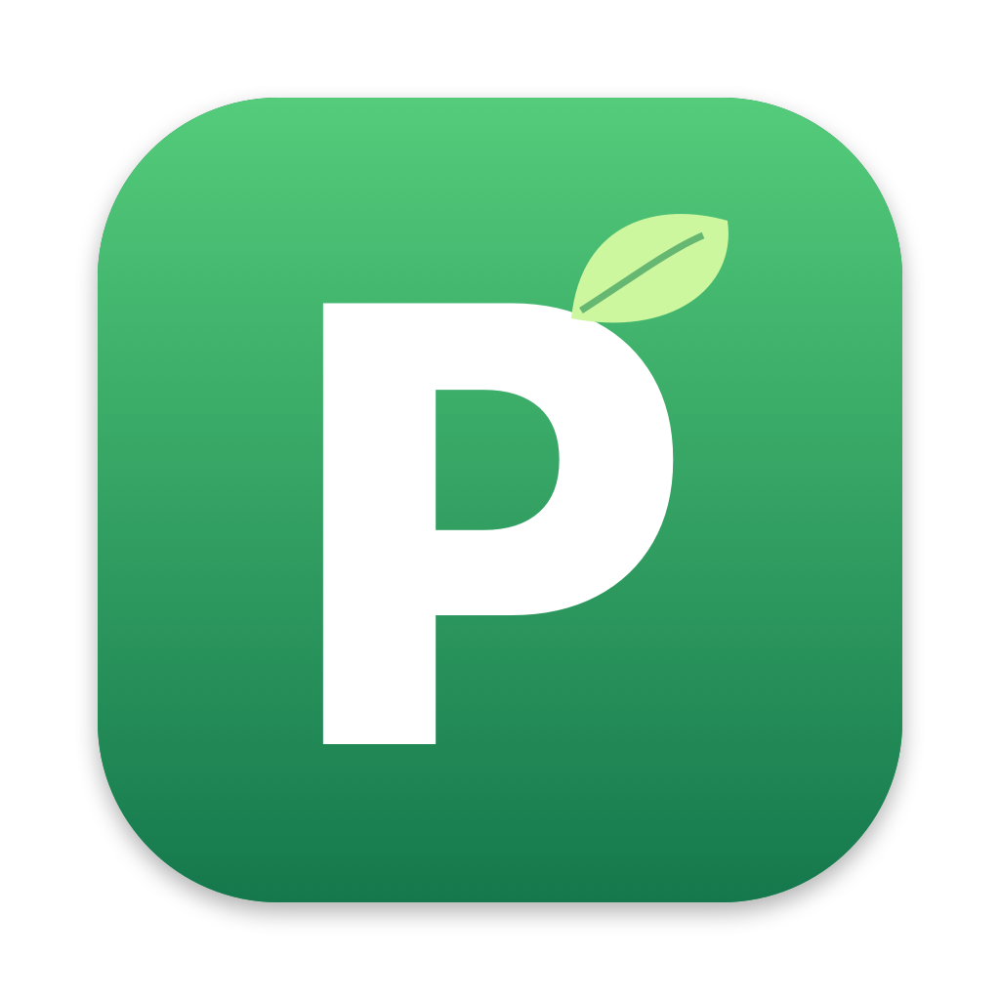

<p align="center"></p>

# macPrune

**See what's really running on your Mac, and cut what you don't need.**

Activity Monitor gives you a long, flat list of names you don't recognize. macPrune shows you *where each process came from*. Every helper, agent and background service sits under the app that owns it, so you can see at a glance that 14 "Helper (Renderer)" processes are really one browser using 3 GB.

Then you can clean them up in one click.

- **Native and light.** Written in Swift and SwiftUI with a 500 KB binary. It uses about 80 MB of memory and low single-digit CPU, and it pauses itself when you can't see it.
- **Private.** No network access, no analytics, no accounts. Everything happens on your Mac.
- **Safe by design.** Nothing is ended without a checklist you review first, and core parts of macOS are never offered.

---

## Features

### Process tree with a connection map
Processes nest under their real parent, or under the app macOS holds *responsible* for them, so launchd-spawned XPC services group under their app instead of being scattered. Select any process to see a live map of:

- **Launched by:** the full parent chain
- **Launched:** its child processes
- **Belongs to app / same app group:** everything macOS attributes to the same app
- **Network:** open connections, with remote hosts highlighted
- **Details:** path, start time, threads, GPU, and total memory including children

### The columns you need
Process Name · Real Memory · % CPU · Threads · PID · User · CPU Time · % GPU

Sort by any column, search by name, PID or path, and switch between tree and flat list views. Select one or more rows, then press **⌫** or **End Process** to Quit or Force Quit.

### Three ways to clean

| Button | What it does |
|---|---|
| ✨ **Quick Clean** | Ends idle background items that started with your login, plus anything you've marked *unwanted*. |
| 🍃 **Fresh Start** | Like a restart without restarting: asks every app and background process to quit, except your Do Not Prune list, macPrune itself and the core parts of macOS. Apps with unsaved work still ask first. |
| 🔥 **Purge** | Flags heavy or suspicious processes, and shows the reason for each one. Heavy means CPU, memory or GPU above your thresholds. Suspicious means running from a temp folder or Downloads, using a system process's name from the wrong location, having its executable deleted while still running, or holding unexpected network connections in the background. |

Every clean opens a checklist first. Purge pre-checks only the strong signals, and never pre-checks the app you're currently using.

### Do Not Prune list
Right-click any process and choose **Add to Do Not Prune List**. Protected processes are highlighted green and are never offered by any clean. Hide them all with one toggle to focus on everything else. You can **import and export** the list as plain text from Settings or the File menu, to back it up or move it to another Mac.

### Other users
Optionally show processes owned by other accounts, such as `_windowserver`, `_spotlight` or another logged-in user (root is excluded). Ending one asks for your admin password, and they're never included in any clean.

### Whole-Mac memory at a glance
The status bar shows memory pressure (green, yellow or red), a bar split into app, wired and compressed memory, and swap usage. Hover over it for the full breakdown.

### Always on top
Pin the window above everything, including full-screen apps, or switch to **compact mode**: a small top-10 list by memory or CPU that's easy to keep in a corner.

---

## Install

macPrune isn't distributed as a signed download yet, so you build it yourself. It takes about a minute.

**Requirements:** macOS 14 Sonoma or later, plus the Xcode Command Line Tools (full Xcode isn't needed).

```bash
xcode-select --install
```

```bash
git clone https://github.com/ycechungAI/macPrune.git
```

```bash
cd macPrune && ./scripts/build-app.sh
```

```bash
open build/Prune.app
```

To keep it, drag `build/Prune.app` into `/Applications`.

## Settings (⌘,)

- Refresh rate: 1, 2 or 5 seconds. In the background it slows to every 5 seconds unless the window is pinned, and it pauses while minimized or covered.
- Purge thresholds for CPU, memory and GPU
- How long after login counts as "started at login" for Quick Clean
- Your Quick Clean (unwanted) and Do Not Prune lists, with import and export

## How it works

| Data | Source |
|---|---|
| Your processes: memory, threads, CPU time, parent, start time | `libproc` (`proc_pidinfo`), read directly from the kernel |
| Which app owns a helper | `responsibility_get_pid_responsible_for_pid` |
| % GPU per process | IOKit GPU client statistics (`AppUsage` → `accumulatedGPUTime`), the same source Activity Monitor uses |
| Other users' processes | `/bin/ps`, which macOS lets read every process |
| Network connections | `lsof`, only for the selected process or during a Purge scan |
| System memory and pressure | `host_statistics64`, `vm.swapusage`, `kern.memorystatus_vm_pressure_level` |

% CPU and % GPU are measured as the change between refreshes, so they appear from the second refresh onward.

### Project layout

```
Sources/Prune/
  PruneApp.swift      App entry, icons, window helpers
  Sampler.swift       libproc / IOKit / ps / lsof sampling, system memory
  ProcessStore.swift  Refresh loop, process tree, ending processes, lists
  Cleaner.swift       Quick Clean, Fresh Start and Purge rules
  ContentView.swift   Table, toolbar, status bar, memory bar
  InspectorView.swift Connection map and details panel
  CleanSheet.swift    Review checklist
  CompactView.swift   Compact top-10 mode
  SettingsView.swift  Settings window
scripts/build-app.sh  Builds and ad-hoc signs build/Prune.app
scripts/make-icon.swift  Draws Resources/AppIcon.icns (swift scripts/make-icon.swift)
```

### Developer switches

```bash
PRUNE_DRYRUN=1 build/Prune.app/Contents/MacOS/Prune
```
Prints what Quick Clean and Fresh Start would offer, then exits. Nothing is ended.

```bash
PRUNE_SNAPSHOT=/tmp/prune.png build/Prune.app/Contents/MacOS/Prune
```
Renders the main window to a PNG five seconds after launch. This doesn't need Screen Recording permission.

## Roadmap

See [ROADMAP.md](ROADMAP.md).
